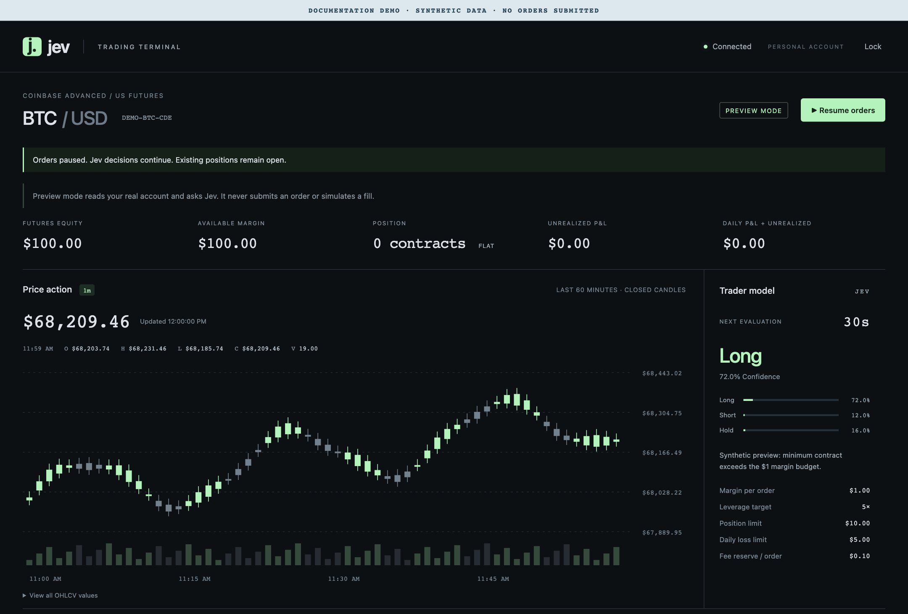
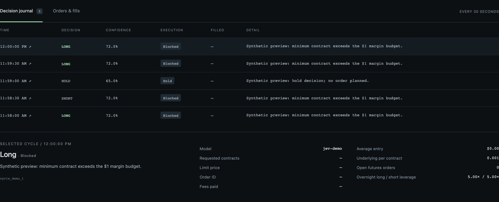

# Jev Trader

[](LICENSE)
[](https://github.com/mcontre4/jev-trader/actions/workflows/ci.yml)

An experimental, self-hosted trading terminal that connects a Jev model to a personal Coinbase Advanced **US futures** account. Review market candles, model decisions, account exposure, and an execution journal in one React interface.

**Starts in preview mode. No profitability is claimed. This is experimental software, not financial advice or a managed trading service.**



*Screenshots show the actual UI with synthetic data. They contain no credentials, real balances, live orders, or evidence of trading performance.*

## What it does

- Evaluates 60 closed one-minute futures candles on a 30-second decision loop.
- Requests typed `long`, `short`, or `hold` decisions from Jev through the TypeSafe API.
- Applies deterministic sizing, confidence, margin, position, fee, and daily-loss checks before execution.
- Uses exchange previews and price-capped fill-or-kill limit orders; unsupported conditions block trading.
- Persists snapshots, decisions, order intents, and execution results in MySQL for review and recovery.
- Provides a token-protected terminal, execution pause/resume, candlestick chart, and decision inspector.

Preview uses the real provider APIs and may incur API charges, but does not submit orders or simulate fills. The project does not provide a backtester, paper exchange, automatic stop-loss, or automatic contract rollover.



## Trading risks — read before connecting an account

**A bot can lose money quickly. Futures leverage can produce losses greater than your deposited margin.** See [Coinbase's margin and liquidation guidance](https://help.coinbase.com/en/coinbase/derivatives/us-derivatives-risk-management-and-liquidations).

- **Model failure:** confidence and probabilities are model outputs, not calibrated success rates. Bad decisions can repeat and accumulate exposure. No strategy or return has been validated by these screenshots or tests.
- **Limits are not guarantees:** the margin budget, position cap, and daily-loss threshold are checks before new orders, not guaranteed maximum losses. Gaps, liquidation, fees, slippage, changing margin requirements, and delayed data can exceed them.
- **Pause is not an exit:** pause, Lock, closing the browser, and stopping the server do not close positions or cancel existing orders. An in-flight submission may finish after pausing. Keep direct Coinbase access for emergency action.
- **Operational failure:** outages, rate limits, stale prices, database failure, ambiguous order responses, and software bugs can interrupt monitoring or execution. Preserve the database and reconcile unresolved orders before resuming.
- **Account security:** anyone with the terminal token may control execution and view account information. Compromised trade credentials can place harmful orders. Use minimal API permissions and no transfer permission.
- **Your responsibility:** verify eligibility, provider terms, local trading rules, and tax/reporting obligations. Model/API charges are separate from exchange fees.

Use only funds you can afford to lose. Begin in preview, independently review the implementation and provider behavior, and supervise live operation. The MIT license supplies the software **as is, without warranty**; it does not certify the bot as safe or profitable.

## Quick start with Docker

You need Git and Docker with Compose v2. Connecting the worker also requires your own Coinbase Advanced account approved for US CFM futures, a CDP **ECDSA / ES256** key with view/trade permission, and a TypeSafe API key for Jev. Never grant transfer permission.

```sh
git clone https://github.com/mcontre4/jev-trader.git
cd jev-trader
cp .env.example .env
chmod 600 .env
```

Edit `.env` locally. Keep it out of commits, issues, screenshots, and chat logs.

| Setting | Purpose |
| --- | --- |
| `COINBASE_API_KEY` | CDP key name, such as `organizations/your-org/apiKeys/your-key` |
| `COINBASE_API_SECRET` | ECDSA PEM private key; preserve literal `\n` inside the quoted value |
| `JEV_API_KEY` | TypeSafe API credential |
| `TERMINAL_TOKEN` | Random token of at least 32 characters; generate one below |
| `MYSQL_PASSWORD` / `MYSQL_ROOT_PASSWORD` | Separate random, URL-safe local database passwords |
| `DATABASE_URL` | Local MySQL URL matching those credentials; Compose supplies its internal URL |
| `TRADING_MODE` | Keep `preview` for initial setup |
| `TRADING_CFM_CONFIRMED` | Keep `false` until you have verified account eligibility |

Generate a different random value for each token/password:

```sh
python3 -c 'import secrets; print(secrets.token_urlsafe(32))'
```

If Python is unavailable, use a password manager to generate URL-safe values. Then start:

```sh
docker compose up --build
```

Open **http://127.0.0.1:8000** and enter `TERMINAL_TOKEN`. Compose initializes the trading tables before starting the terminal. It publishes the application and database only on localhost. Keep those bindings; this is a single-operator local application.

With incomplete credentials, the terminal may show an unconfigured state. Providing all required credentials activates the worker. Preview still uses live data and paid API calls. The token remains in browser memory and is cleared on reload/Lock; provider credentials stay on the server.

To stop the containers:

```sh
docker compose down
```

**Do not add `--volumes` / `-v` when you need to retain history or pending order intents.** Stopping containers leaves exchange positions open.

## Configuration and live operation

Defaults in [.env.example](.env.example) request BTC, a $1 margin budget per order, a $10 position-notional limit, and a $5 daily-loss threshold. These are example inputs, not recommendations or a promise that a trade is possible. The 5× target must match exchange margin requirements. A $1 margin budget usually cannot meet a US futures contract minimum; **blocked decisions and zero orders are expected**.

The worker continues making decisions while execution is paused. `TRADING_AUTOSTART` controls the initial execution state when the database control row is created; it does not override an existing persisted pause/resume state.

Before considering live mode, review [the execution rules and recovery procedure](docs/trading/README.md). Verify provider access in preview, inspect the contract and expiry, pin `TRADING_PRODUCT_ID`, review every risk setting, and confirm CFM eligibility. Live mode requires both `TRADING_MODE=live` and `TRADING_CFM_CONFIRMED=true`, followed by service recreation:

```sh
docker compose up -d --force-recreate terminal
```

**Treat live startup as permission to submit real orders.** A persisted enabled state can allow immediate submissions. Use one installation per account; separate databases do not coordinate orders. Manual trading can race the bot. There is no automatic rollover or guaranteed loss protection. See [Coinbase's leverage and margin explanation](https://help.coinbase.com/en/coinbase/derivatives/us-derivatives-leverage-margin).

## Local development

Use Python 3.12+, Poetry 2.2+, Node.js 22.12+ (the Docker build uses Node 22), and Docker for database tests. Configure `.env` as above, with `DATABASE_URL` pointing to `127.0.0.1:3307` and matching MySQL credentials.

```sh
poetry -C backend install
npm --prefix frontend ci
docker compose up -d mysql
poetry -C backend run python -m app.trading.composition --init-db
poetry -C backend run uvicorn app.main:app --host 127.0.0.1 --port 8000 --workers 1
```

In another terminal:

```sh
npm --prefix frontend run dev
```

Open the URL printed by Vite. It proxies `/api` to the backend. Run one API worker to avoid duplicate background loops.

The schema initializer is idempotent for new tables. It does not migrate existing schemas. Back up the database before upgrades and preserve pending intents during recovery.

## Architecture

The trading application uses **FastAPI, SQLAlchemy, MySQL, React, TypeScript, and Vite**. Inner layers use ports and pure domain logic; composition roots wire infrastructure. PostgreSQL/Redis and LangChain/LangGraph dependencies are also present in the backend starter; trading persistence uses MySQL and the Jev integration uses HTTP.

```text
backend/src/app/trading/
  domain/       Trading entities, sizing rules, and risk policy
  ports/        Exchange, model, persistence, and coordination interfaces
  application/  RunCycle, GetTerminal, and SetExecution use cases
  adapters/     Coinbase, Jev, MySQL, settings, and HTTP boundaries
  composition.py
backend/src/app/shared/  Shared domain ports and infrastructure
backend/tests/          Unit tests, explicit fakes, and integration tests
frontend/src/TradingTerminal.tsx
docs/trading/           Detailed operation and recovery documentation
```

## Checks and contributions

```sh
poetry -C backend run pytest
poetry -C backend run mypy
poetry -C backend run ruff check src tests
poetry -C backend run python scripts/check_hexagonal_boundaries.py --root src
poetry -C backend run tach check
npm --prefix frontend test
npm --prefix frontend run build
npm --prefix frontend audit
```

The full backend suite starts disposable MySQL and PostgreSQL containers and requires Docker. Provider contract tests use injected HTTP transports; they do not place live trades or prove exchange eligibility. CI runs tests, type/lint/architecture checks, and a Git-history secret scan.

Read [CONTRIBUTING.md](CONTRIBUTING.md) before sending a change. Install [Gitleaks](https://github.com/gitleaks/gitleaks) and the hooks to check future commits:

```sh
poetry -C backend run pre-commit install
gitleaks git --redact=100 --log-opts="--all" .
```

Scanners cannot guarantee that a repository contains no secrets. Report vulnerabilities privately using [SECURITY.md](SECURITY.md). If credentials enter Git, revoke/rotate them immediately; deleting a file does not remove old revisions. Follow [GitHub's sensitive-data removal procedure](https://docs.github.com/en/authentication/keeping-your-account-and-data-secure/removing-sensitive-data-from-a-repository).

## License

[MIT](LICENSE) © 2026 Martin Contreras. Dependencies and third-party services retain their own licenses and terms. This project is not affiliated with or endorsed by Coinbase or TypeSafe.
